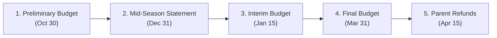

# TAMHA Team Budget & Financial Management Standard Operating Procedure (SOP)

**Truro Area Minor Hockey Association (TAMHA)**  
*Document Ref: TAMHA-SOP-FIN-002 | Season: 2026–2027 | Executive Lead: Joe Zappia (VP Finance)*

---

## 1. Executive Summary & Why the System Was Rebuilt

Every minor hockey team that collects parent fees, solicits corporate sponsorships, or conducts fundraising initiatives is required under **Hockey Nova Scotia (HNS) Regulations** and **TAMHA Policy** to operate under a formal, transparent team budget.

### Problems with the Legacy Template
The legacy TAMHA budget spreadsheet had significant architectural limitations:
1. **Broken Hardcoded Linkages:** Formulas relied on brittle row offsets (`=Income!F9`, `=Expenses!B16`) that produced `#REF!` errors whenever a team added or removed rows.
2. **Misaligned Columns:** Revenue and Expenses were laid out side-by-side with mismatched row heights and misaligned subtotals.
3. **No Bank Reconciliation:** Treasurers lacked an integrated tool to balance credit union bank statements against their operating ledger.
4. **No Player Fee Tracking:** Managers had to maintain separate, disconnected spreadsheets to track jersey deposits, fee installments, and cash calls.

### The New Master Budget System (2026–2027)
The rebuilt **TAMHA Team Budget Master Template** provides an executive-grade, 5-sheet financial operating system designed specifically for volunteer Managers and Treasurers:

*   **Sheet 1: `Budget Summary`** — High-level executive dashboard comparing Projected vs. Actual YTD vs. Variance, dynamically calculating per-player costs and parent out-of-pocket expenses.
*   **Sheet 2: `Income`** — Granular revenue tracker covering Sponsorship Tiers, Team Fundraising Events, Parent Fee Installments, and Jersey Deposits Held in Trust.
*   **Sheet 3: `Expenses`** — Categorized operational cost ledger covering Association Fees ($9,500 Rep Fees inclusive of sweater fund; $11,500 for AAA; $0 for C-League), Tournaments, Extra Ice & Officials, Apparel, Events, and Bank Fees.
*   **Sheet 4: `Bank Rec` *(Optional Team Tool)*** — Monthly bank reconciliation balancing the Mosaik Credit Union statement against the ledger with automated `$0.00` variance validation.
*   **Sheet 5: `Roster & Fee Tracker` *(Optional Team Tool)*** — Individual 21-player ledger tracking jersey deposit cheques, fee installments, cash calls, and end-of-season return sign-offs with auto-counted roster detection.

---

## 2. Official Template Access Links

| Platform | Access Method | Link |
| :--- | :--- | :--- |
| **Official Team Budget (Recommended)** | Direct Access via Google Drive | [**Google Drive > "Shared with me"**](https://drive.google.com/drive/shared-with-me) |
| **Microsoft Excel (.xlsx)** | Local File in Repository | `templates/TAMHA_Team_Budget_Master_Template.xlsx` |

> [!TIP]
> **Already Started a Spreadsheet? Don't Panic!**  
> For the 2026–2027 season, if you have already started drafting your team budget in Excel or another format, please don't re-type it from scratch. We will be happy to merge your existing numbers into the official format for you! Simply email what you have to TAMHA Finance (`vpfinance@trurominorhockey.ca`) or your manager coordinator.

---

## 2.1 Distribution Model & Reporting Architecture

### Adopted Association Model: Centralized Pre-Population & Direct Drive Sharing
To ensure association-wide financial oversight and eliminate administrative friction for team volunteers, TAMHA uses the **Centralized Pre-Population Model**:
1. **Automated Generation:** Using verified submissions from the Bank Signer Intake Form and the Mosaik account mapping ledger, VP Finance generates a dedicated, pre-populated Google Sheet for each of the 28 TAMHA teams in a central Drive directory (`TAMHA 2026-2027 Team Budgets`).
2. **Pre-Populated Data:**
   * Team Name, Division, and Tier (Rep vs C-League).
   * Authorized Signing Officers (Head Coach, Manager, Treasurer) and contact details.
   * Official 9-digit Mosaik Credit Union Account #.
   * Baseline Association Fees ($9,500 for Rep including sweater fund; $11,500 for AAA; $0 for C teams).
3. **Delegated Access via "Shared with me":** VP Finance shares each team sheet directly with that team's Manager and Treasurer with **Editor** permissions. Volunteers simply log into Google Drive and find their sheet immediately under [**"Shared with me"**](https://drive.google.com/drive/shared-with-me)—eliminating "Request Access" permission errors.
4. **Association Scraping & Reporting:** Because VP Finance retains primary ownership of all 28 team sheets within the TAMHA Google Workspace, an automated aggregation script or `IMPORTRANGE` dashboard can scrape high-level budget figures across all 28 teams in seconds—providing instant association-wide cash position and solvency audits without chasing down individual file attachments.

### Key Consideration: Rep Teams vs. C-League (House) Teams
* **Rep Teams (AA / A / B):**
  * Pay mandatory TAMHA Rep Fees of **$9,500 total** for the 2026–2027 season, split into two equal installments ($4,750 on Nov 30 and $4,750 on Jan 31).
  * **Comprehensive Inclusions (No Sticker Shock):** To prevent double-charging families, the $9,500 Rep fee comprehensively bundles:
    1. **Mandatory Jersey/Sweater Fund:** (previously billed separately as an additional $550 charge).
    2. **HNS & Conference League Scheduling Fees:** Association-wide league and affiliation fees are fully covered.
    3. **Official Team Game Socks:** Two (2) pairs per player supplied directly at equipment pickup.
    *On the Expenses tab, these rows are listed at `$0.00` with explanatory notes.*
  * Collect $150/player Jersey Deposits (held in trust).
  * Incur tournament entry fees, exhibition ice costs, and ref/timekeeper cash payouts.
* **AAA Rep Teams:**
  * Pay **$11,500 total** ($5,750 per installment: Nov 30 and Jan 31) to account for additional scheduled ice allocations.
* **C-League / House Teams:**
  * **Do NOT pay Rep fees** ($0.00 default; core ice time and league operations are covered by base TAMHA player registration).
  * Collect $150/player Jersey Deposits (held in trust, unless your division receives sponsored jerseys).
  * Operating budgets focus on tournament entry, extra exhibition/practice ice, apparel/socks, and team activities/year-end events.

---

## 3. Season Milestones & Submission Deadlines

TAMHA enforces five strict financial reporting milestones throughout the season:

| Milestone | Target Date | Audience | Description & Requirements |
| :--- | :--- | :--- | :--- |
| **Milestone 1** | **October 30** | Parents & VP Finance | **Preliminary Team Budget:** Presented at introductory parent meeting and approved by >75% majority vote. Submitted to `vpfinance@trurominorhockey.ca`. |
| **Milestone 2** | **December 31** | Parent Group | **Mid-Season Financial Statement:** Interim ledger update shared with all parents showing funds raised, expenses paid, and remaining balance. |
| **Milestone 3** | **January 15** | VP Finance | **Interim Budget Submission:** Submitted to VP Finance to verify second Rep Fee installment ($4,750) and second-half solvency. |
| **Milestone 4** | **March 31** | VP Finance | **Final Year-End Budget & Bank Rec:** Complete reconciled financial statement submitted to VP Finance prior to season closeout. |
| **Milestone 5** | **April 15** | Parent Group | **Final Statement & Jersey Deposit Returns:** Final statement distributed to parents. All uncashed jersey deposit cheques returned/destroyed upon return of game sweaters. |

---

## 4. Sheet-by-Sheet Operating Guide

### Sheet 1: `Budget Summary`
*   **Important Manager Note:** Do **NOT** manually type budget figures into this summary tab! All numbers roll up automatically from the detailed line items entered on the `Income` and `Expenses` tabs.
*   **Metadata Input (Rows 4–7):** Enter your Team Division & Name, Team Tier (Rep vs House), Staff names, Mosaik Account #, and Reporting Stage.
*   **Dynamic Roster Size (Cell `G4`):** Automatically counts players entered on the `Roster & Fee Tracker` tab (`=IF(COUNTA('Roster & Fee Tracker'!B5:B25)>0, COUNTA('Roster & Fee Tracker'!B5:B25), 17)`). If you do not use the optional Roster tab, simply type your team's roster count directly into cell `G4`.
*   **Section 1.0 (Revenue Rollup):** Automatically pulls subtotals from the `Income` tab.
*   **Section 2.0 (Expense Rollup):** Automatically pulls subtotals from the `Expenses` tab.
*   **Section 3.0 (Per-Player Breakdown):**
    *   *Gross Cost Per Player:* Total team budget divided by roster count.
    *   *Fundraising/Sponsor Subsidy:* Dollars raised per player from non-parent sources.
    *   *Net Parent Fee Per Player:* True out-of-pocket cost per family.

### Sheet 2: `Income`
*   **1.0 Sponsorships:** Track Major ($1,000+), Gold ($500), Silver ($250), and Bronze ($100) sponsors. Track payment method and whether a sponsor receipt was issued.
*   **2.0 Fundraising:** Enter planned events (Bottle Drive, 50/50, Grand in Your Hand). Enter Projected Net vs. Actual Net after expenses.
*   **3.0 Parent Contributions:** Calculates Rep Fee installments dynamically based on the Association Fees entered on `Expenses!E6` and `Expenses!E7` divided by the roster count in `Budget Summary!G4` (e.g. $4,750 ÷ 17 = $279.41 per player per installment for standard Rep teams). Also tracks optional team cash calls.
*   **4.0 Jersey Deposits (Held in Trust):** Track the $150/player deposit (both Rep and House). **Crucial Rule:** Jersey deposits are liability trust funds—they must NOT be spent on team operating costs.
*   **5.0 Miscellaneous & Interest:** Record bank interest or account credits.

### Sheet 3: `Expenses`
*   **1.0 Association Fees:**
    *   TAMHA Rep Fees: $9,500 total ($4,750 on Nov 30; $4,750 on Jan 31) for AA, A, B; $11,500 total ($5,750 on Nov 30; $5,750 on Jan 31) for AAA; $0.00 for C-League.
    *   Mandatory Sweater Fund: Included in the $9,500 Rep Fee total (listed at $0.00 on the ledger; no separate payment required).
    *   HNS & League Scheduling Fees: Included in the $9,500 Rep Fee total (listed at $0.00 on the ledger; covered by association).
    *   Regional Playoff Assessment Fees: Included in Rep Fee / covered by association (listed at $0.00).
*   **2.0 Tournaments:** Record entry fees for all approved tournaments (typically 3–4 events per season).
*   **3.0 Extra Ice & Game Officials:** Track exhibition and additional practice ice hours, plus referee and timekeeper cash payouts.
*   **4.0 Team Apparel & Items:** Practice jerseys (Forward & Defence colours for intra-squad drills), sponsor banner printing, player name bars, first aid kits, and pucks. *Note: Official game socks (2 pairs/player) are included in the Rep fee and listed at $0.00.*
*   **5.0 Team Activities:** Holiday party, year-end banquet, player snacks, and coaching staff appreciation gifts.
*   **6.0 Operating & Banking:** Mosaik Credit Union annual account fee ($15 flat fee; no monthly fees or bank supply charges), optional administrative supplies, and emergency contingency buffer.
*   **7.0 Jersey Deposit Refunds:** 100% refund of jersey deposits upon return of jerseys in April.

### Sheet 4: `Bank Rec` *(Optional Team Management Tool)*
> [!NOTE]
> The Bank Reconciliation sheet is an optional team convenience ledger provided to assist treasurers with balancing accounts. It is **NOT** required for your official TAMHA budget milestone submissions.

*   Every month upon receiving your Mosaik Credit Union bank e-statement:
    1. Enter the **Ending Balance per Bank Statement** in cell `E7`.
    2. Enter any **Outstanding Deposits** (e.g. cheques deposited on the 31st that haven't cleared).
    3. Enter any **Outstanding Withdrawals** (e.g. uncashed cheques written to vendors or TAMHA).
    4. Verify cell `E30` (`Unreconciled Variance`). It must display **`$0.00`** with the green **`✅ BALANCED`** banner.

### Sheet 5: `Roster & Fee Tracker` *(Optional Team Management Tool)*
> [!NOTE]
> The Roster & Fee Tracker is an optional team convenience tool to track family accounts. It is **NOT** required for your official TAMHA budget milestone submissions.

*   Row-by-row tracking for up to 21 players on your team roster:
    *   Jersey Deposit ($150 - Cheque # or Cash date)
    *   Rep Fee Installment 1 (dynamically linked to per-player installment amount)
    *   Rep Fee Installment 2 (dynamically linked to per-player installment amount)
    *   Team Cash Call ($100)
    *   Automated Total Paid & Balance Due calculations (rows with no player name remain clean and blank).
    *   End-of-Season Jersey Return checkbox to clear deposit cheques.

---

## 5. Important Compliance Directives from VP Finance & TAMHA Policy Framework

1.  **Dual Authorization:** All cheques and online outbound payments require two (2) authorized signatures. Never issue a pre-signed blank cheque.
2.  **No Personal Bank Accounts:** All team transactions must flow exclusively through the official Mosaik Credit Union team account. Personal bank accounts are strictly prohibited.
3.  **Sponsorships vs. Fundraising vs. Parent Contributions:**
    *   **Corporate Sponsorships:** Contributions from local businesses in exchange for advertising/promotional value (banners, sponsor bars). Every business sponsor must receive an official TAMHA Team Sponsorship Receipt. Note: These are commercial advertising expense receipts, **not** registered charitable tax deduction receipts.
    *   **Team Fundraising Initiatives:** Public ticket draws, 50/50 raffles, and bottle drives belong to the team and association as a whole. Under Hockey Nova Scotia and TAMHA regulations, **fundraising money cannot be distributed to parents as cash profits or bonuses**.
    *   **Parent Fee Contributions:** Rep fee installments and operational cash calls paid by families out-of-pocket. Any parent fee assessment must be presented to the parent group and approved by at least a **>75% majority vote** at the initial parent meeting.
4.  **Zero Deficit Policy:** Teams are strictly prohibited from projecting or operating at a deficit. Projected revenues must equal or exceed projected expenses at all milestone reporting stages.
5.  **Surplus Distribution Policy:** Any year-end operating surplus remaining after all expenses and jersey refunds must be returned equally to parents **only up to the total amount of direct parent cash contributions paid during the season**. Excess fundraising cannot be paid out as cash to families and must be reinvested into team player development/activities or remitted to TAMHA.
6.  **Jersey Deposits Held in Trust:** Mandatory $150 deposits for all teams (Rep & House) must be held in trust (uncashed cheques dated May 15, 2027 or segregated funds). They are liabilities, must never be spent on team operations, and must be refunded 100% upon return of game jerseys in April.
